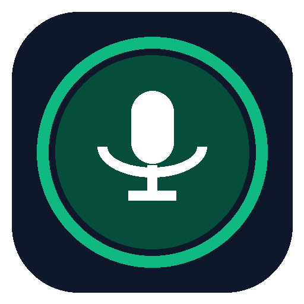
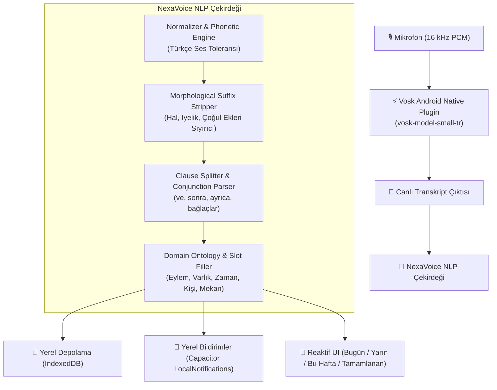

# 🎙️ NexaVoice AI (Çevrimdışı Türkçe Sesli Saha & Görev Asistanı)

<p align="center">
  
</p>

<p align="center">
  <strong>100% Çevrimdışı • Tek Dokunuş • Türkçe Morfolojik NLP • Gayrimenkul & Saha Odaklı</strong>
</p>

<p align="center">
  
  
  
  
  
  
</p>

---

## 🌟 Proje Özeti

**NexaVoice AI**, sahada çalışan gayrimenkul danışmanları ve saha ekipleri için geliştirilmiş, **hiçbir internet veya bulut API bağlantısına ihtiyaç duymayan**, tamamen cihaz üzerinde (Edge-AI) çalışan akıllı bir sesli görev asistanıdır.

Kullanıcı tek dev konuşma butonuna basar ve serbestçe konuşur:
> *"Bugün saat üçte villa görüşmesi var, yarın tapu randevusu, Ahmet Bey'i akşam ara."*

**NexaVoice AI**, konuşmayı 1 saniye içinde kelime kelime dinler, Türkçe eklemeli dil morfolojisini çözümler, tek cümleyi bağımsız görevlere böler ve **Tarih, Saat, Kategori, Öncelik, Kişi ve Mekan** alanlarını otomatik olarak yapılandırılmış görev kartlarına dönüştürür.

---

## 🎯 Marka Kimliği & GitHub Bilgileri

| Özellik | Tanım |
|---|---|
| **Resmi Ürün Adı** | **NexaVoice AI** *(Nexa: Nexus/Bağlayıcı Çekirdek + Voice AI)* |
| **Önerilen Repo Adı** | `nexavoice-ai` veya `nexavoice-tr` |
| **Slogan (TR)** | *100% Çevrimdışı, Türkçe Doğal Dil İşleme Yetenekli Akıllı Saha & Görev Asistanı* |
| **Tagline (EN)** | *100% Offline Edge-AI Turkish Voice-to-Task Assistant for Field Agents* |
| **Hedef Kitle** | Gayrimenkul danışmanları, saha satış temsilcileri, şantiye şefleri, acenteler |

---

## 🏗️ Sistem Mimarisi



---

## 🧠 Türkçe Dil Zekası & Geliştirme Yolları

### 1. Akustik Seviye (STT) Toleransı
- **Problem**: Vosk Kaldi modeli gürültülü ortamlarda Türkçe ünsüz sertleşmelerini veya yumuşamalarını (`ç/c`, `ş/s`, `ğ/y`, `p/b`, `t/d`) karıştırabilir.
- **NexaVoice Çözümü**: **Türkçe Fonetik Levenshtein Algoritması (`charCostTr`)**. Türkçe ses değişim matrisi ile Vosk yanlış duysa bile sektör kelimeleri (`ekspertiz`, `kapora`, `kadastro`, `noter`) %90+ benzerlikle yakalanır.

### 2. Türk Morfolojik Ek Sıyırıcı (Lightweight Lemmatizer)
- Türkçenin eklemeli yapısında kelimeler uzar: *"villanın"*, *"tapudaki"*, *"sözleşmelerle"*, *"ararsın"*.
- Kod içerisindeki kural tabanlı morfolojik sıyırıcı (`stripTurkishSuffixes`), harici Java/Zemberek bağımlılığı olmadan kökleri ve yumuşamaları anında bulur:
  - `villaya` ➔ `villa`
  - `tapudan` ➔ `tapu`
  - `borcu` ➔ `borç`
  - `senedi` ➔ `senet`

### 3. Çoklu Görev Ayrıştırma (Clause Splitting)
- Zaman zarfları (`öğleden sonra`, `yarım saat sonra`) bağlaç olan `sonra` kelimesinden ayırt edilir.
- `ve`, `ayrıca`, `bir de`, `ondan sonra` gibi bağlaçlar görevleri birbirinden izole eder.

---

## 🚀 Kurulum ve Derleme (Build)

### Gereksinimler
- Node.js (v18+)
- Java JDK 17
- Android SDK (API 24 - 34)

### Adım Adım Derleme

```bash
# 1. Bağımlılıkları yükleyin
npm install

# 2. Web varlıklarını Android projesine senkronize edin
npx cap sync android

# 3. Debug APK derleyin
cd android
./gradlew assembleDebug

# 4. İmzalı Release APK derleyin
./gradlew assembleRelease
```

Derlenen APK dosyaları projedeki `dist_apk/` klasöründe yer alır:
- `dist_apk/app-debug.apk` (~99 MB - Vosk modeli gömülü)
- `dist_apk/app-release.apk` (~98 MB - Keystore ile imzalı)

---

## 🧪 Test Seti & Doğrulama

Sistem 32 adet gerçek hayat gayrimenkul ses senaryosuyla otomatik test edilmektedir:

```bash
# Node.js NLP test koşucusu
node tests/test_runner.js

# Veya Python test çalıştırıcısı
python scripts/run_nlp_tests.py
```

**Sonuç:**
```text
Toplam Test Senaryosu : 32
Başarılı Senaryo     : 32 (%100 Başarı)
Toplam Üretilen Görev: 39 (Beklenen: 39)
Test Koşu Süresi      : 15 ms
```

---

## 🔮 Yol Haritası (v2 & v3)

1. **Sherpa-ONNX (Zipformer Streaming ASR)**: Vosk yerine mobil NPU hızlandırmalı ONNX Conformer/Zipformer modeline geçiş ile daha yüksek transkript doğruluğu.
2. **On-Device Small Language Model (SLM)**: Gemma-2B / Phi-3 mini INT4 modellerinin MediaPipe LLM Inference veya ONNX Runtime ile cihazda çalıştırılması.
3. **Kişiselleştirilmiş Rehber Entegrasyonu**: Danışmanın telefon rehberindeki isimlerin Kaldi/Vosk gramerine dinamik olarak eklenmesi (Context Biasing).
4. **CRM Entegrasyonu**: Tamamlanan görevlerin offline SQLite/CSV üzerinden yerel CRM veya ERP sistemlerine tek tıkla aktarılması.

---

## 📄 Lisans
Bu proje [MIT Lisansı](LICENSE) ile lisanslanmıştır. Tamamen açık kaynak ve çevrimdışıdır.
